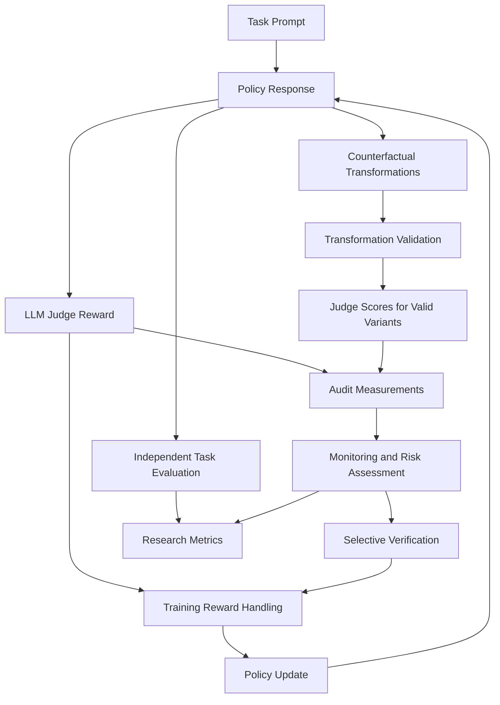

# PreHack-RL

**Counterfactual Auditing and Selective Verification for Reinforcement Learning with Imperfect LLM Judges**

PreHack-RL investigates how unreliable LLM judges affect reward optimization, whether counterfactual audits can expose exploitable judge weaknesses, and whether selectively verifying suspicious rewards can improve learning outcomes.

> **Project status:** Active development. The synthetic Best-of-N baseline and initial counterfactual audit checks are implemented. Real-model evaluation, RL training, predictive monitoring, and intervention experiments are planned.

## Overview

LLM judges can provide reward signals for training other models. However, a judge may reward superficial features—such as confidence, verbosity, or formatting—even when an answer is incorrect.

Optimizing these imperfect rewards can favor responses that receive higher judge scores without improving actual task performance.

PreHack-RL studies this problem through a staged experimental framework:

1. Establish controlled judge failures.
2. Audit responses using validated counterfactual transformations.
3. Measure judge reward and independent task correctness separately.
4. Investigate whether audit signals predict future exploitation.
5. Evaluate selective verification under matched computational budgets.

The project aims to produce reproducible evidence about when auditing helps, when it fails, and what it costs.

## Research Questions

- Can counterfactual audits distinguish presentation preferences from sensitivity to correctness?
- Are audits of current-policy outputs more informative than a fixed audit set?
- Can audit measurements predict subsequent reward exploitation?
- Can selective verification reduce exploitation while preserving useful learning?
- How do results change across policies, judges, tasks, and failure mechanisms?

These are research questions, not established capabilities.

## Proposed Framework



This diagram describes the planned framework. The current implementation provides synthetic generation, scoring, selection, verification, and audit checks.

### Counterfactual Auditing

The auditor examines two types of transformations:

**Correctness-preserving transformations**

Change presentation while preserving task-relevant content. Examples include controlled formatting changes or confidence-language edits.

**Correctness-changing transformations**

Introduce a verifiable error while preserving presentation as closely as possible.

Every transformation must be validated. A presentation change is not automatically irrelevant under every evaluation rubric, and modifying an already incorrect answer does not necessarily make it worse.

### Selective Verification

The planned intervention uses audit measurements to select suspicious rewards for independent checking.

Experiments will compare audit-guided verification with random verification and simple selection rules under matched budgets. They will specify how verified, replaced, or withheld rewards affect training.

## Development Phases

| Phase | Name | Objective | Status |
|---|---|---|---|
| 01 | Controlled Experimental Foundation | Validate synthetic judges, Best-of-N selection, audit checks, and reproducible logging | Initial implementation complete |
| 02 | Counterfactual Audit Engine | Build text transformations, answer parsing, validation, and reusable audit metrics | Planned |
| 03 | Real LLM Judge Evaluation | Evaluate real judge behavior and selection pressure on model-generated responses | Planned |
| 04 | Reinforcement Learning Baseline | Train a small policy and establish whether learned reward exploitation occurs | Planned |
| 05 | Audit Prediction and Monitoring | Compare current-policy and static audits; evaluate prospective warnings | Planned |
| 06 | Selective Verification and Intervention | Test audit-guided verification against budget-matched controls | Planned |
| 07 | Defense Comparison and Generalization | Compare relevant defenses, held-out settings, and component ablations | Planned |
| 08 | Research Synthesis and Release | Consolidate reproducible experiments, analysis, figures, and manuscript | Planned |

### Phase 01 — Controlled Experimental Foundation

Construct synthetic judges with known behavior and measure how Best-of-N selection affects proxy reward and true correctness.

**Completion criterion:** Results agree with known mathematical behavior and the pipeline passes correctness and reproducibility tests.

### Phase 02 — Counterfactual Audit Engine

Extend the structured auditor to text responses. Implement answer parsing, transformation eligibility, validity checks, and audit aggregation.

**Completion criterion:** Measurements reflect judge behavior rather than invalid transformations or parsing errors.

### Phase 03 — Real LLM Judge Evaluation

Connect policy and judge models. Audit generated responses and evaluate Best-of-N selection using independent correctness checks.

**Completion criterion:** Obtain repeatable measurements and distinguish systematic effects from ordinary scoring variability.

### Phase 04 — Reinforcement Learning Baseline

Introduce small-policy RL training, checkpoint evaluation, and monitoring-only audits.

**Completion criterion:** Establish whether actual learned exploitation occurs before making prevention claims.

### Phase 05 — Audit Prediction and Monitoring

Evaluate whether earlier audit measurements predict later exploitation. Compare against fixed audit sets and simpler monitors.

**Completion criterion:** Measure predictive usefulness, including lead time, false alarms, missed events, and runs where hacking never occurs.

### Phase 06 — Selective Verification and Intervention

Use audit signals to select rewards for verification and integrate the resulting reward handling into training.

**Completion criterion:** Evaluate improvements in independently verified performance against equally budgeted alternatives.

### Phase 07 — Defense Comparison and Generalization

Compare selected established defenses and extend evaluation across models, tasks, judge errors, and seeds.

**Completion criterion:** Identify reproducible strengths, limitations, and cost tradeoffs beyond one favorable setting.

### Phase 08 — Research Synthesis and Release

Prepare the reproducibility package and research report around supported findings, including negative results.

**Completion criterion:** Main claims can be traced to documented, reproducible experiments.

## Experiment Roadmap

| ID | Experiment | Phase |
|---|---|---|
| `exp_00` | Synthetic Best-of-N | 01 |
| `exp_01` | Synthetic Counterfactual Audit | 01 |
| `exp_02` | Transformation Validation | 02 |
| `exp_03` | Audit Metric Validation | 02 |
| `exp_04` | LLM Judge Audit | 03 |
| `exp_05` | LLM Best-of-N | 03 |
| `exp_06` | GRPO Control | 04 |
| `exp_07` | GRPO with an Imperfect Judge | 04 |
| `exp_08` | Policy-Conditioned vs. Static Audit | 05 |
| `exp_09` | Early-Warning Prediction | 05 |
| `exp_10` | Audit-Guided Verification | 06 |
| `exp_11` | Budget-Matched Interventions | 06 |
| `exp_12` | Existing Defense Comparison | 07 |
| `exp_13` | Unseen Bias and Distribution Shift | 07 |
| `exp_14` | Component Ablations | 07 |
| `exp_15` | Cost–Performance Analysis | 07 |

Currently, `pilot.py` supports Experiment 00 and initial structured checks for Experiment 01. The remaining experiments are planned.

## Current Implementation

The synthetic pilot generates arithmetic problems and samples responses from a fixed distribution:

| Response Type | Probability |
|---|---:|
| Correct, concise | 0.55 |
| Incorrect, confident | 0.35 |
| Incorrect, concise | 0.10 |

The control judge scores correct answers at `0.70` and incorrect answers at `0.10`.

The biased judge adds a confidence bonus of `0.65`, capped at `1.0`. An incorrect confident answer therefore scores `0.75`, exceeding a correct concise answer’s `0.70`.

Both judges receive identical candidate pools. Increasing N uses nested prefixes of each pool.

The exact expected accuracies are:

```text
Control: 1 - 0.45**N
Biased:  0.65**N - 0.10**N
```

The separate audit covers all four correctness/style combinations. It measures presentation sensitivity and correct–incorrect score separation.

## Initial Synthetic Results

Means across seeds `42`, `43`, and `44`, with 2,000 trials per seed:

| Judge | Candidates | Accuracy | Mean Proxy Reward |
|---|---:|---:|---:|
| Control | 1 | 54.82% | 0.4289 |
| Control | 8 | 99.82% | 0.6989 |
| Control | 32 | 100.00% | 0.7000 |
| Confidence-biased | 1 | 54.82% | 0.6552 |
| Confidence-biased | 8 | 3.27% | 0.7484 |
| Confidence-biased | 32 | 0.00% | 0.7500 |

These results validate a deliberately constructed selection failure.

**They do not demonstrate real LLM vulnerabilities, learned reward hacking, predictive capability, or successful prevention.** The selection distribution intentionally excludes correct confident candidates, limiting generalization.

## Quick Start

### Requirements

- Python 3.10 or newer.
- No third-party dependencies for the current synthetic experiments.
- No GPU, model downloads, or API keys required.

From the repository root:

```bash
# Run tests.
python3 -m unittest discover -s tests -v

# Run the synthetic experiments.
python3 pilot.py \
  --trials 2000 \
  --seeds 42 43 44 \
  --output runs/my-first-run
```

For a quick smoke run:

```bash
python3 pilot.py \
  --trials 100 \
  --seeds 42 \
  --output runs/smoke-test
```

Use a new output directory for each run. Existing run directories are not overwritten.

## Generated Outputs

| File | Contents |
|---|---|
| `manifest.json` | Configuration, Python version, source hashes, and limitations |
| `trials.jsonl` | Candidate pools and selected outcomes |
| `audits.jsonl` | Counterfactual probes, scores, validity, and audit measurements |
| `summary.csv` | Per-seed experiment results |
| `report.md` | Aggregate results and interpretation |

## Repository Organization

Current implementation:

```text
PreHack-RL/
├── README.md
├── REPOSITORY_STRUCTURE.md
├── pilot.py
├── prehack/
│   ├── __init__.py
│   └── core.py
├── tests/
│   └── test_pipeline.py
└── runs/
```

As the project develops:

- `prehack/` will contain reusable research components.
- `experiments/` will contain experiment-specific instructions and runners.
- `configs/` will contain supported experiment and model configurations.
- `docs/` will contain methodology, related work, and reproducibility documentation.
- `results/` will contain curated summaries and reports.
- `runs/` will contain raw local execution artifacts.
- `paper/` will contain manuscript sources when writing begins.

See `REPOSITORY_STRUCTURE.md` for the proposed full layout.

## Evaluation Principles

- Measure proxy reward and independent task correctness separately.
- Validate counterfactual transformations and report rejected probes.
- Separate training, calibration, and test data.
- Keep variants of a base example in the same data split.
- Freeze prediction rules before evaluating held-out trajectories.
- Include false alarms, missed warnings, and no-hacking runs.
- Compare interventions under matched evaluation budgets.
- Record seeds, configurations, model versions, prompts, and data provenance.
- Report uncertainty and variation across independent runs.
- Use negative findings to revise hypotheses and project scope.

## Limitations

PreHack-RL is an ongoing research project. Real-model effectiveness, generalization, early-warning value, and intervention performance remain untested.

Final-answer verification does not establish the validity of every reasoning step. Stronger judges and judge ensembles are not automatically ground truth.

Related-work comparisons will be documented after checking primary sources. The project does not claim established novelty or guaranteed publication outcomes.

## Next Milestone

Develop the text-based counterfactual audit engine, including answer parsing, transformation validation, and structured judge outputs.

Then connect real models and measure judge failures before introducing RL training.
